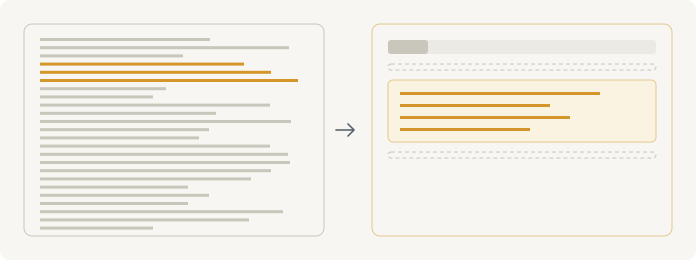
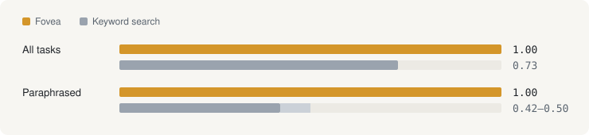

<p align="center">
<picture>
<source media="(prefers-color-scheme: dark)" srcset="docs/assets/readme-hero-dark.svg">

</picture>
</p>

<h1 align="center">Fovea</h1>

<p align="center">Sharp focus on what matters in your coding agent's tool output; the rest stays in the periphery.</p>

<p align="center"><b>Status:</b> pre-release · <b>For:</b> Claude Code · <b>License:</b> MIT</p>

<p align="center"><a href="#how-it-works">How it works</a> · <a href="#evidence">Evidence</a> · <a href="#install">Install</a> · <a href="#limitations">Limitations</a></p>

Fovea is a plugin for Claude Code. When a shell command returns a large output, Fovea splits it into natural blocks, asks a fast decision model which blocks matter for the agent's current task, and passes those through **verbatim**. Everything else collapses into short outline lines, so the agent knows exactly what it is not seeing and can read it in full at any time.

**Select, never delete.** Fovea never paraphrases, and every omission is visible.

## What the agent sees

Task: *"find when the rate limiter was added"*. The agent runs `git log --stat -n 40`. (The numbers are from a real run; the commit content is illustrative.)

<p align="center">
<picture>
<source media="(prefers-color-scheme: dark)" srcset="docs/assets/readme-before-after-dark.svg">

</picture>
</p>

<details>
<summary>Before: 29,658 chars, 627 lines</summary>

```
commit a91f3c2d07e4b1…
    docs: fix typo in CONTRIBUTING
…
```

</details>

After Fovea: 1,261 chars (4%)

```
[fovea 3f9a1c07: 1/41 blocks, 4% · full: cat ~/.fovea/out/3f9a1c07.txt · kept 30d]
[skip 1-66: docs: fix typo in…; ci: cache pnpm st…; api: bump zod to…]
[67-85]
commit 8c41e2d07a5b93…
    api: add token-bucket rate limiter to /search
 src/api/ratelimit.ts   | 84 ++++++++++
 src/api/search.ts      | 12 +-
 test/ratelimit.test.ts | 61 ++++++++
[skip 86-627: search: tune ranking w…; api: retry on 429…; +34]
```

- `[fovea …]`: blocks kept, share of text, and the command that prints the full original.
- `[skip 1-66: …]`: the periphery: a line range and a short outline of what it holds.
- `[67-85]`: the fovea: a relevant block, verbatim, with its original line numbers.

## How it works

<p align="center">
<picture>
<source media="(prefers-color-scheme: dark)" srcset="docs/assets/readme-how-it-works-dark.svg">

</picture>
</p>

1. **Split.** The output is cut into natural blocks: one commit, one file's matches, one section, one function.
2. **Judge.** A fast decision model (System 1, in Kahneman's sense) returns the probability that each block matters for the current task. All blocks go in one request, in about half a second.
3. **Select.** Blocks at or above the threshold (0.2) pass through verbatim. The rest become outline lines. The full output is saved for 30 days.

Some things are never filtered: outputs under about 1,000 tokens, errors and stack traces, reads of a file the agent is about to edit, outputs where the agent already chose the range itself (`sed -n 10,50p`, `| head`), and outputs that look like they hold secrets. If the judge is unavailable, times out, or no block clears the threshold, the output passes through unchanged.

> Kahneman calls it WYSIATI: *what you see is all there is*. A mind reasons confidently from whatever it was shown. A filter that silently drops text makes an agent confidently wrong, so Fovea always shows what it left out.

## Evidence

Validated on 5 Nov 2026: 30 tool outputs in six formats, 1,140 blocks, 90 agent tasks.

- **Recall 1.00** at threshold 0.2: every needed block kept in 90 of 90 tasks, with 29% of the text kept (majority vote of three labelers).
- **Keyword search (BM25)** keeping the same 29%: recall 0.73 overall, 0.42-0.50 on paraphrased tasks.
- **Calibration:** among 2,940 blocks the judge scored below 0.2, not one was needed.
- **Robustness:** block position and order have no effect; on tasks with no answer, the highest score is 0.06 or below.
- **Cost:** median 0.45 s and about $0.0006 per output.

| Format | Text kept (threshold 0.3) |
|---|---|
| JSON | 6% |
| git log | 7% |
| markdown | 7% |
| grep | 32% |
| code | 65% |

<p align="center">
<picture>
<source media="(prefers-color-scheme: dark)" srcset="docs/assets/readme-recall-dark.svg">

</picture>
</p>

Source code is the weak spot: files of code keep about 65% of their text, so the saving there is small.

<details>
<summary>How the test set was built</summary>

Six formats, 30 outputs, 90 tasks. Tasks came in three phrasings: with exact identifiers, paraphrased, and casual Russian. Labels come from three independent labeler models (Sonnet, Opus, Minimax); pairwise agreement 97.8-99.3%, Cohen's kappa 0.81-0.93. Still open: live tasks from real sessions, finer splitting of code, a comparison with blind fixed windows, and tasks with no answer in the output. For publication the test set will be rebuilt on a different codebase.

</details>

## Install

Fovea is a Claude Code plugin. In Claude Code, run:

```
/plugin install fovea --marketplace w2lker/fovea
```

On Claude Code older than 2.1.275, add the marketplace first: `/plugin marketplace add w2lker/fovea`, then `/plugin install fovea@w2lker`.

The install dialog asks for an **OpenRouter API key** for the default judge. You can leave it empty if `OPENROUTER_API_KEY` is already set in your environment. Without a key, Fovea does nothing.

**Requirements:** Claude Code 2.1.121 or later (the version that lets a hook replace a tool's output) and `python3` 3.9 or later on your PATH. Fovea uses the standard library only.

The plugin adds two hooks. The `PostToolUse` hook on Bash does the filtering. The `SessionStart` hook adds a short note, about 40 tokens, telling the agent how to read Fovea's headers and how to report a bad filter.

**Turn it off:** `/plugin disable fovea@w2lker`, or set `FOVEA_MODE=off`.

<details>
<summary>Manual install without the plugin system</summary>

Clone the repository, put `bin/fovea` on your PATH, and add the two hooks to `~/.claude/settings.json`. Use absolute paths to your clone.

```json
{
  "hooks": {
    "PostToolUse": [
      { "matcher": "Bash", "hooks": [ { "type": "command", "command": "python3 /path/to/fovea/fovea/hook.py", "timeout": 10 } ] }
    ],
    "SessionStart": [
      { "hooks": [ { "type": "command", "command": "python3 /path/to/fovea/fovea/session_start.py" } ] }
    ]
  }
}
```

</details>

### What leaves your machine

There is no telemetry. For each large Bash output that Fovea filters, it sends the following to the judge endpoint (by default OpenRouter, which routes to TypeSafe Jev):

- the output, split into blocks;
- a short task description made of the command, its description, and short excerpts of your latest message and the agent's latest reply.

Nothing else is sent. Logs, notes and saved full outputs stay in `~/.fovea` on your machine. Full outputs are deleted after 30 days. Logs never contain the output text.

### Report and notes

```bash
# Savings and measured losses over the last 7 days
fovea report --days 7
```

Inside Claude Code the `fovea` command is on the agent's PATH, so you can simply ask the agent to run the report. When the agent notices that filtering went wrong, it runs `fovea note <id> "<what went wrong>"`. Notes appear in `fovea report` next to the savings.

### Configuration

All settings are environment variables.

| Variable | Default | Meaning |
|---|---|---|
| `FOVEA_MODE` | `active` | `active` replaces outputs; `shadow` only scores and logs; `off` disables Fovea. |
| `FOVEA_BASE_URL` | `https://openrouter.ai/api/alpha/decisions` | Judge endpoint (decisions format). |
| `FOVEA_API_KEY_ENV` | `OPENROUTER_API_KEY` | Name of the variable that holds the key. |
| `FOVEA_MODEL` | `~typesafe/jev-latest` | Decision model. The only one calibrated so far. |
| `FOVEA_THRESHOLD` | `0.2` | Keep blocks scored at or above this. |
| `FOVEA_MIN_TOP` | `0.5` | Replace only if some block scores at least this; otherwise the judge is unsure and the output passes whole. |
| `FOVEA_TIMEOUT` | `4` | Judge timeout in seconds; on timeout the output passes through. |
| `FOVEA_MIN_CHARS` | `3500` | Smaller outputs pass untouched (about 1,000 tokens). |
| `FOVEA_SHADOW_SAMPLE` | `0.15` | Share of eligible outputs left unchanged but scored, to measure real losses. |
| `FOVEA_HOME` | `~/.fovea` | Where full outputs, logs and notes live. |
| `FOVEA_RETENTION_DAYS` | `30` | How long full outputs are kept. |
| `FOVEA_MAX_STORE_MB` | `500` | Size cap for saved outputs; the oldest go first. |

Any endpoint or model other than the defaults is your choice and responsibility, including the threshold. The endpoint must speak the decisions format; chat models need an adapter that v1 does not ship.

## Limitations

- **Bash outputs only.** File reads through the editor tool and MCP tool outputs are not filtered yet.
- **Outputs at Claude Code's Bash limit pass through.** Claude Code cuts them before the hook sees them, so a selection would be incomplete.
- **Little saving on code.** Source files keep about 65% of their text. Nothing is lost, but the gain is small.
- **One calibrated judge.** Thresholds hold for TypeSafe Jev. Other models need their own calibration.
- **A modest test set.** 30 outputs and 90 tasks. Check your own losses with `fovea report`.
- **Pre-release.** Interfaces and defaults may change before the first tagged version.

## Credits

Built by Roman Bova ([@w2lker](https://github.com/w2lker)). Judge model: TypeSafe Jev. The System 1 / System 2 framing and WYSIATI come from Daniel Kahneman, *Thinking, Fast and Slow*. MIT license.
